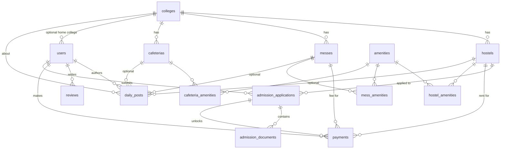

# Hostel Hive — Backend Documentation

Complete reference for the Hostel Hive backend: architecture, database schema, API, business rules and operations.

- **Stack:** Python 3.12 · FastAPI · SQLAlchemy 2 · PostgreSQL (Neon) · Drizzle ORM (migrations) · JWT auth
- **Interactive API docs:** `http://localhost:8000/docs` (Swagger) and `/redoc` once the server runs

---

## Table of contents

1. [What the product does](#1-what-the-product-does)
2. [Architecture & project layout](#2-architecture--project-layout)
3. [Setup & configuration](#3-setup--configuration)
4. [Roles & authentication](#4-roles--authentication)
5. [Database schema](#5-database-schema)
6. [Migrations workflow (Drizzle)](#6-migrations-workflow-drizzle)
7. [API reference](#7-api-reference)
8. [Key flows](#8-key-flows)
9. [Business rules & validation](#9-business-rules--validation)
10. [Errors](#10-errors)
11. [Testing](#11-testing)
12. [Security notes & known limitations](#12-security-notes--known-limitations)

---

## 1. What the product does

A website where users **compare hostels, messes and cafeterias across multiple colleges**.

- The main idea is **on-campus vs off-campus**: every hostel, mess and cafeteria is tagged `on_campus` (inside the college) or `off_campus` (outside it), so a visitor can see what the college's own facilities cost against what is available outside.
- A single **central admin** (the "central college") manages all data and publishes **daily posts** (mess menus, hostel updates, notices) about the other colleges.
- A **student** applies for a hostel, uploads identity documents (passport photo, university fee receipt, Aadhaar, PAN), submits the application and then **pays rent** (and optionally the security deposit) on the site. Mess fees can also be paid.

---

## 2. Architecture & project layout

```
Browser / frontend ──HTTP/JSON──▶ FastAPI (app/) ──SQLAlchemy──▶ Neon PostgreSQL
                                      │                              ▲
                                      └── private file storage       │
                                          (identity documents)        │
                         Drizzle (drizzle/) ── creates/migrates schema┘
```

**Two schema definitions, one database.** Drizzle (TypeScript) owns the schema and migrations; SQLAlchemy (Python) models mirror it so FastAPI can query. They must be kept in sync by hand (see [§6](#6-migrations-workflow-drizzle)). The app never calls `create_all` in production.

```
hostel-hive-backend/
├── app/
│   ├── main.py            # FastAPI app, CORS, router registration, startup admin bootstrap
│   ├── config.py          # Settings from env / .env (DATABASE_URL, SECRET_KEY, ...)
│   ├── database.py        # SQLAlchemy engine + session dependency
│   ├── models.py          # SQLAlchemy models + enums (mirror of drizzle/schema.ts)
│   ├── schemas.py         # Pydantic request/response models
│   ├── security.py        # password hashing, JWT, auth dependencies, role checks
│   ├── bootstrap.py       # creates the single admin from ADMIN_EMAIL/ADMIN_PASSWORD
│   ├── payments.py        # payment gateway abstraction (mock by default)
│   ├── storage.py         # private file storage for identity documents
│   └── routers/
│       ├── auth.py        # register / login / me
│       ├── colleges.py
│       ├── amenities.py
│       ├── listings.py    # hostels, messes, reviews (+ shared helpers)
│       ├── cafeterias.py
│       ├── admissions.py  # hostel admission + document upload + review
│       ├── posts.py       # daily posts feed
│       ├── compare.py     # comparison & price endpoints
│       └── payments.py
├── drizzle/
│   ├── schema.ts          # source of truth for the DB schema
│   └── migrations/        # generated SQL (0000_init, 0001_add_cafeterias, 0002_hostel_admission)
├── drizzle.config.ts      # reads DATABASE_URL
├── package.json           # db:generate / db:migrate / db:push / db:studio
├── seed.py                # optional sample data
├── tests/test_api.py
├── requirements.txt
├── .env / .env.example
└── storage/               # uploaded documents (git-ignored, created at runtime)
```

---

## 3. Setup & configuration

### Run locally

```bash
# 1. Database schema (Neon) — needs DATABASE_URL in .env
npm install
npm run db:migrate

# 2. API
python3 -m venv .venv
.venv/bin/pip install -r requirements.txt
.venv/bin/uvicorn app.main:app --reload       # http://localhost:8000/docs

# 3. Optional sample data (3 colleges, hostels, messes, cafeterias, amenities)
.venv/bin/python seed.py

# 4. Tests (SQLite, never touches Neon)
.venv/bin/pytest
```

### Environment variables (`.env`)

| Variable | Default | Purpose |
|---|---|---|
| `DATABASE_URL` | `sqlite:///./hostel_hive.db` | Neon connection string. Shared by FastAPI **and** Drizzle. `postgresql://` is auto-converted to `postgresql+psycopg://` for SQLAlchemy. |
| `SECRET_KEY` | dev placeholder | JWT signing key. **Must** be changed in production (`openssl rand -hex 32`). |
| `ACCESS_TOKEN_MINUTES` | `1440` | JWT lifetime (24 h). |
| `ADMIN_EMAIL`, `ADMIN_PASSWORD`, `ADMIN_NAME` | unset / `Central Admin` | The single admin is created on startup if none exists. |
| `PAYMENT_PROVIDER` | `mock` | Only `mock` is implemented. |
| `STORAGE_DIR` | `./storage` | Where identity documents are written. |
| `MAX_UPLOAD_MB` | `5` | Per-file upload limit. |
| `CORS_ORIGINS` | `*` | Comma-separated allowed origins. Restrict in production. |

---

## 4. Roles & authentication

| Role | How created | Can do |
|---|---|---|
| `visitor` | public `POST /auth/register` | Browse, compare, review, apply for admission, pay |
| `student` | public `POST /auth/register` (default) | Same as visitor |
| `central_admin` | **only** via `ADMIN_EMAIL`/`ADMIN_PASSWORD` bootstrap | Everything: manage colleges, hostels, messes, cafeterias, amenities, daily posts; review admissions; view all documents |

- **Only one admin can exist.** Enforced in the database by the partial unique index `one_central_admin` (not just in code). Registering with `role: central_admin` returns `403`.
- **Auth scheme:** `Authorization: Bearer <JWT>` (HS256, claims `sub` = user id, `exp`).
- **Login** is OAuth2 password form (`application/x-www-form-urlencoded`), where `username` is the **email**.
- Missing/invalid token on a protected route → `401`. Wrong role → `403`.

---

## 5. Database schema

PostgreSQL on Neon, 14 tables. Money is stored as `double precision` (see [limitations](#12-security-notes--known-limitations)). Enumerations are stored as plain `varchar` (no native PG enum types) and validated by the API.

### 5.1 Entity relationship diagram



`reviews` points at a hostel/mess/cafeteria through `target_type` + `target_id` (polymorphic, no foreign key).

### 5.2 Tables

Conventions: **PK** primary key (`integer generated by default as identity`) · **FK** foreign key · **NN** not null.

#### `users`
| Column | Type | Notes |
|---|---|---|
| id | integer PK | |
| name | varchar(120) NN | |
| email | varchar(255) NN | unique (`ix_users_email`) |
| password_hash | varchar(255) NN | `salt$pbkdf2-sha256` (200k iterations) |
| role | varchar(30) NN | `visitor` \| `student` \| `central_admin`, default `student` |
| college_id | integer FK → colleges | optional |
| created_at | timestamptz NN | default now |

Indexes: `ix_users_email` (unique), **`one_central_admin`** — unique on `role` `WHERE role = 'central_admin'` (max one admin).

#### `colleges`
| Column | Type | Notes |
|---|---|---|
| id | integer PK | |
| name | varchar(200) NN | unique |
| city | varchar(100) NN | indexed |
| address | varchar(300) NN | default `''` |
| is_central | boolean NN | default false; marks the central college |

#### `amenities` — admin-managed catalog
| Column | Type | Notes |
|---|---|---|
| id | integer PK | |
| name | varchar(60) NN | unique, stored lower-case (`wifi`, `ac`, `ro_water`, …) |
| category | varchar(10) NN | `hostel` \| `mess` \| `cafeteria`, indexed |

A hostel can only use `hostel` amenities, a mess `mess` ones, a cafeteria `cafeteria` ones.

#### `hostels`
| Column | Type | Notes |
|---|---|---|
| id | integer PK | |
| college_id | integer NN FK → colleges | the college it belongs to (on-campus) or is nearest to (off-campus); indexed |
| name | varchar(200) NN | |
| location | varchar(30) NN | `on_campus` \| `off_campus`; indexed |
| gender | varchar(30) NN | `boys` \| `girls` \| `co_ed`, default `co_ed` |
| address | varchar(300) NN | default `''` |
| distance_from_college_km | double NN | default 0 |
| monthly_rent | double NN | must be > 0 |
| security_deposit | double NN | default 0 |
| room_type | varchar(50) NN | default `double` (single/double/triple/dorm…) |
| total_beds | integer NN | default 0 |
| available_beds | integer NN | default 0; decremented on first paid rent |
| wifi_mbps | integer | nullable |
| has_ac, attached_bathroom, power_backup, cctv, includes_mess | boolean NN | default false |
| is_active | boolean NN | default true; delete = set false (soft delete) |

#### `messes` — monthly meal plan
| Column | Type | Notes |
|---|---|---|
| id | integer PK | |
| college_id | integer NN FK → colleges | indexed |
| name | varchar(200) NN | |
| location | varchar(30) NN | `on_campus` \| `off_campus` |
| address | varchar(300) NN | |
| distance_from_college_km | double NN | |
| food_type | varchar(30) NN | `veg` \| `non_veg` \| `both` |
| monthly_price | double NN | must be > 0 |
| price_per_meal | double | nullable |
| meals_per_day | integer NN | default 2 |
| hygiene_rating | double | nullable, 0–5 |
| seating_capacity | integer | nullable |
| is_active | boolean NN | soft delete |

#### `cafeterias` — pay-per-item outlet (snacks, tea, quick meals)
| Column | Type | Notes |
|---|---|---|
| id | integer PK | |
| college_id | integer NN FK → colleges | indexed |
| name | varchar(200) NN | |
| location | varchar(30) NN | `on_campus` \| `off_campus` |
| address | varchar(300) NN | |
| distance_from_college_km | double NN | |
| food_type | varchar(30) NN | `veg` \| `non_veg` \| `both` |
| cuisine | varchar(100) NN | free text, e.g. `Snacks, Thali` |
| avg_meal_price | double NN | typical spend for one meal; > 0 |
| min_item_price | double | nullable (e.g. price of a chai) |
| opens_at, closes_at | varchar(5) | nullable, `HH:MM` 24h |
| hygiene_rating | double | nullable, 0–5 |
| seating_capacity | integer | nullable |
| home_delivery | boolean NN | default false |
| is_active | boolean NN | soft delete |

#### Amenity link tables (many-to-many, cascade on delete)
`hostel_amenities(hostel_id, amenity_id)` · `mess_amenities(mess_id, amenity_id)` · `cafeteria_amenities(cafeteria_id, amenity_id)` — composite PK, both FKs `ON DELETE CASCADE`.

#### `daily_posts` — daily feed from the central college
| Column | Type | Notes |
|---|---|---|
| id | integer PK | |
| author_id | integer NN FK → users | the admin |
| college_id | integer NN FK → colleges | which college the post is about; indexed |
| kind | varchar(30) NN | `mess_menu` \| `cafeteria_menu` \| `hostel_update` \| `notice`; indexed |
| mess_id / hostel_id / cafeteria_id | integer FK, nullable | optional link to the subject |
| title | varchar(200) NN | |
| body | text NN | default `''` |
| post_date | date NN | defaults to today; indexed |
| created_at | timestamptz NN | |

#### `reviews`
| Column | Type | Notes |
|---|---|---|
| id | integer PK | |
| user_id | integer NN FK → users | |
| target_type | varchar(10) NN | `hostel` \| `mess` \| `cafeteria` |
| target_id | integer NN | id in the matching table (no FK); indexed |
| rating | integer NN | 1–5 |
| comment | text NN | default `''` |
| created_at | timestamptz NN | |

`avg_rating` returned on listings is the mean of these ratings.

#### `admission_applications`
| Column | Type | Notes |
|---|---|---|
| id | integer PK | |
| user_id | integer NN FK → users | indexed |
| hostel_id | integer NN FK → hostels | indexed |
| status | varchar(30) NN | `draft` → `submitted` → `approved` \| `rejected`; default `draft` |
| reject_reason | text | set when rejected |
| created_at | timestamptz NN | |
| submitted_at, reviewed_at | timestamptz | nullable |

Unique constraint `uq_admission_user_hostel (user_id, hostel_id)` — one application per student per hostel.

#### `admission_documents` — metadata only (file lives in private storage)
| Column | Type | Notes |
|---|---|---|
| id | integer PK | |
| application_id | integer NN FK → admission_applications | `ON DELETE CASCADE`; indexed |
| doc_type | varchar(30) NN | `passport_photo` \| `fee_receipt` \| `aadhaar` \| `pan` |
| storage_key | varchar(100) NN | random filename on disk (never the user's filename) |
| original_name | varchar(255) NN | for display only |
| content_type | varchar(50) NN | detected from file bytes: `image/jpeg`, `image/png`, `application/pdf` |
| size_bytes | integer NN | |
| uploaded_at | timestamptz NN | |

Unique constraint `uq_admission_doc_type (application_id, doc_type)` — re-uploading replaces the previous file.

#### `payments`
| Column | Type | Notes |
|---|---|---|
| id | integer PK | |
| user_id | integer NN FK → users | indexed |
| kind | varchar(30) NN | `hostel_rent` \| `mess_fee` |
| hostel_id / mess_id | integer FK, nullable | depending on `kind` |
| application_id | integer FK → admission_applications | set for `hostel_rent` |
| months | integer NN | 1–12, default 1 |
| include_deposit | boolean NN | hostel rent only; adds `security_deposit` to the amount |
| amount | double NN | **computed server-side**, never trusted from the client |
| currency | varchar(3) NN | default `INR` |
| status | varchar(30) NN | `created` → `paid` \| `failed` |
| provider | varchar(30) NN | `mock` |
| provider_order_id | varchar(100) NN | |
| provider_payment_id | varchar(100) | set on confirmation |
| created_at | timestamptz NN | |
| paid_at | timestamptz | |

### 5.3 Enum reference

| Enum | Values |
|---|---|
| Role | `visitor`, `student`, `central_admin` |
| Location | `on_campus`, `off_campus` |
| Gender | `boys`, `girls`, `co_ed` |
| FoodType | `veg`, `non_veg`, `both` |
| PostKind | `mess_menu`, `cafeteria_menu`, `hostel_update`, `notice` |
| AdmissionStatus | `draft`, `submitted`, `approved`, `rejected` |
| DocType | `passport_photo`, `fee_receipt`, `aadhaar`, `pan` |
| PaymentKind | `hostel_rent`, `mess_fee` |
| PaymentStatus | `created`, `paid`, `failed` |
| Amenity category / review target | `hostel`, `mess`, `cafeteria` |

---

## 6. Migrations workflow (Drizzle)

The API is Python, but migrations are handled by Drizzle ORM (TypeScript) as requested.

| Command | What it does |
|---|---|
| `npm run db:generate` | Diffs `drizzle/schema.ts` against previous migrations and writes a new SQL file in `drizzle/migrations/` |
| `npm run db:migrate` | Applies pending migrations to the database in `DATABASE_URL` |
| `npm run db:push` | Pushes the schema directly without a migration file (dev only) |
| `npm run db:studio` | Opens Drizzle Studio to browse data |

**To change the schema, edit both files:**

1. [`drizzle/schema.ts`](drizzle/schema.ts) — the source of truth
2. [`app/models.py`](app/models.py) — the SQLAlchemy mirror (column names, types, nullability must match)
3. `npm run db:generate` → review the SQL → `npm run db:migrate`

Applied so far: `0000_init`, `0001_add_cafeterias`, `0002_hostel_admission`.

---

## 7. API reference

Base URL: `http://localhost:8000`. All bodies are JSON unless stated. 🔒 = Bearer token required, 👑 = admin only.

### 7.1 Auth — `/auth`

| Method | Path | Auth | Description |
|---|---|---|---|
| POST | `/auth/register` | — | Create a `student` (default) or `visitor` account; returns a token |
| POST | `/auth/login` | — | Form login (`username` = email, `password`); returns a token |
| GET | `/auth/me` | 🔒 | Current user |

```jsonc
// POST /auth/register
{ "name": "Asha", "email": "asha@example.com", "password": "min6chars", "role": "student", "college_id": 1 }
// 201 → TokenOut
{ "access_token": "eyJ...", "token_type": "bearer",
  "user": { "id": 7, "name": "Asha", "email": "asha@example.com", "role": "student", "college_id": 1 } }
```
`409` email already registered · `403` role `central_admin` requested.

```bash
curl -X POST /auth/login -d "username=asha@example.com&password=min6chars"
```

### 7.2 Colleges — `/colleges`

| Method | Path | Auth | Description |
|---|---|---|---|
| GET | `/colleges?city=` | — | List (sorted by name), optional case-insensitive city filter |
| GET | `/colleges/{id}` | — | One college |
| POST | `/colleges` | 👑 | Create |

Body: `{ "name", "city", "address"?, "is_central"? }`.

### 7.3 Amenities — `/amenities`

| Method | Path | Auth | Description |
|---|---|---|---|
| GET | `/amenities?category=` | — | Catalog; `category` = `hostel`/`mess`/`cafeteria` |
| POST | `/amenities` | 👑 | `{ "name": "wifi", "category": "hostel" }` — name is lower-cased; `409` if it exists |
| DELETE | `/amenities/{id}` | 👑 | Removes it from every listing too (cascade) |

### 7.4 Hostels — `/hostels`

| Method | Path | Auth | Description |
|---|---|---|---|
| GET | `/hostels` | — | List with filters (below) |
| GET | `/hostels/{id}` | — | One hostel |
| POST | `/hostels` | 👑 | Create |
| PUT | `/hostels/{id}` | 👑 | Full replace of fields (incl. amenities) |
| DELETE | `/hostels/{id}` | 👑 | Soft delete (`is_active = false`), `204` |

**Filters (GET list):** `college_id`, `city`, `location` (`on_campus`/`off_campus`), `gender`, `min_price`, `max_price` (monthly rent), `has_ac`, `includes_mess`, `amenity` (repeatable, **all** must match), `sort` = `price` (default) \| `distance`, `limit` (default 50, max 200), `offset`.

**Create/update body:**
```jsonc
{
  "college_id": 1, "name": "Sunrise PG", "location": "off_campus", "gender": "boys",
  "address": "MP Nagar", "distance_from_college_km": 1.2,
  "monthly_rent": 6500, "security_deposit": 5000, "room_type": "double",
  "total_beds": 40, "available_beds": 6,
  "wifi_mbps": 200, "has_ac": true, "attached_bathroom": true,
  "power_backup": true, "cctv": true, "includes_mess": false,
  "amenities": ["wifi", "ac", "laundry"]          // names from /amenities (category hostel)
}
```
Response adds `id`, `is_active`, `avg_rating` (null if no reviews). Unknown amenity or amenity of another category → `422`.

### 7.5 Messes — `/messes`

Same shape as hostels (GET list/one open; POST/PUT/DELETE 👑, DELETE is soft).

**Filters:** `college_id`, `city`, `location`, `food_type`, `min_price`, `max_price` (monthly), `min_hygiene`, `amenity` (repeatable), `sort` = `price` \| `distance` \| `hygiene`, `limit`, `offset`.

**Body:** `college_id, name, location, address?, distance_from_college_km?, food_type?, monthly_price, price_per_meal?, meals_per_day?, hygiene_rating? (0–5), seating_capacity?, amenities[]` (category `mess`).

### 7.6 Cafeterias — `/cafeterias`

Same pattern. **Filters:** `college_id`, `city`, `location`, `food_type`, `min_price`, `max_price` (avg meal price), `min_hygiene`, `home_delivery`, `amenity` (repeatable), `sort` = `price` \| `distance` \| `hygiene`, `limit`, `offset`.

**Body:**
```jsonc
{ "college_id": 1, "name": "Chai Tapri", "location": "off_campus", "food_type": "both",
  "cuisine": "Chai, Maggi", "avg_meal_price": 50, "min_item_price": 10,
  "opens_at": "07:00", "closes_at": "23:30",          // HH:MM, otherwise 422
  "hygiene_rating": 3.4, "seating_capacity": 20, "home_delivery": true,
  "distance_from_college_km": 0.2, "amenities": ["late_night"] }   // category cafeteria
```

### 7.7 Reviews — `/reviews`

| Method | Path | Auth | Description |
|---|---|---|---|
| POST | `/reviews` | 🔒 | `{ "target_type": "hostel"\|"mess"\|"cafeteria", "target_id": 3, "rating": 1-5, "comment"?: "" }` — `404` if the target does not exist |
| GET | `/reviews?target_type=&target_id=` | — | Newest first; `target_type` is required |

### 7.8 Daily posts — `/posts`

| Method | Path | Auth | Description |
|---|---|---|---|
| GET | `/posts` | — | Feed, newest first. Filters: `college_id`, `kind`, `on` (date `YYYY-MM-DD`), `limit` (max 200), `offset` |
| GET | `/posts/today` | — | Posts whose `post_date` is today |
| POST | `/posts` | 👑 | Create |
| DELETE | `/posts/{id}` | 👑 | Hard delete, `204` |

```jsonc
// POST /posts
{ "college_id": 2, "kind": "mess_menu", "mess_id": 4,
  "title": "Today's menu", "body": "Lunch: Dal, Rice, Paneer", "post_date": "2026-10-04" }  // post_date optional → today
```
`404` if `college_id`, `mess_id`, `hostel_id` or `cafeteria_id` does not exist.

### 7.9 Comparison — `/compare`  (public)

`ids` is a comma-separated list of **2–6 distinct** ids, e.g. `?ids=1,2,3`. Unparseable → `422`; any id missing/inactive → `404`.

| Path | Returns |
|---|---|
| `GET /compare/hostels?ids=` | `items[]` (full hostel objects with `avg_rating`), `cheapest_id`, `closest_id`, `amenity_matrix` |
| `GET /compare/messes?ids=` | `items[]`, `cheapest_id`, `best_hygiene_id` (null if none rated), `amenity_matrix` |
| `GET /compare/cafeterias?ids=` | `items[]`, `cheapest_id`, `closest_id`, `best_hygiene_id`, `amenity_matrix` |
| `GET /compare/colleges?ids=` | Per college, for both `on_campus` and `off_campus`: hostel rent stats, mess price stats, cafeteria meal-price stats, available beds, amenity unions |
| `GET /compare/prices/{college_id}` | **Core view:** on-campus vs off-campus for hostel, mess and cafeteria around one college |
| `GET /compare/city-overview?city=` | Per college in the city: on/off-campus average hostel rent, mess price, cafeteria meal price |

`amenity_matrix` example — which listing has which amenity:
```json
{ "3": { "ac": false, "wifi": true }, "5": { "ac": true, "wifi": true } }
```

`/compare/prices/{college_id}` response (abridged):
```jsonc
{
  "college": { "id": 1, "name": "ABC Engineering College", "city": "Bhopal" },
  "hostel": {
    "on_campus":  { "summary": { "count": 1, "min": 4500, "max": 4500, "avg": 4500 },
                    "items": [ { "id": 1, "name": "ABC Boys Hostel", "price": 4500, "distance_km": 0 } ] },
    "off_campus": { "summary": { "count": 2, "min": 3800, "max": 6500, "avg": 5150 }, "items": [ ... ] },
    "off_campus_vs_on_campus_avg": 650     // negative ⇒ outside is cheaper; null if either side is empty
  },
  "mess": { ... same shape ... },
  "cafeteria": { ... same shape, price = avg_meal_price ... }
}
```
`summary` is `{count, min, max, avg}` or `null` when there are no items. Only active listings are included.

### 7.10 Hostel admission — `/admissions`

| Method | Path | Auth | Description |
|---|---|---|---|
| POST | `/admissions` | 🔒 student/visitor | Start an application `{ "hostel_id": 1 }`. Idempotent: returns the existing one. `409` if the hostel has no free beds |
| GET | `/admissions?status=&hostel_id=` | 🔒 | Student: own applications. Admin: everyone's |
| GET | `/admissions/{id}` | 🔒 | Owner or admin. Others get `404` |
| PUT | `/admissions/{id}/documents/{doc_type}` | 🔒 owner | Upload / replace a document. **multipart/form-data**, field `file` |
| GET | `/admissions/{id}/documents/{doc_type}` | 🔒 owner or admin | Download the file |
| POST | `/admissions/{id}/submit` | 🔒 owner | Submit once all 4 documents are present |
| POST | `/admissions/{id}/review` | 👑 | `{ "approve": true }` or `{ "approve": false, "reason": "Blurry PAN" }` |

`AdmissionOut`:
```jsonc
{ "id": 12, "user_id": 7, "hostel_id": 3, "status": "draft", "reject_reason": null,
  "created_at": "...", "submitted_at": null, "reviewed_at": null,
  "documents": [ { "doc_type": "pan", "original_name": "pan.jpg", "content_type": "image/jpeg",
                   "size_bytes": 83211, "uploaded_at": "..." } ],
  "missing_documents": ["passport_photo", "fee_receipt", "aadhaar"] }
```

```bash
curl -X PUT /admissions/12/documents/aadhaar -H "Authorization: Bearer $T" -F "file=@aadhaar.pdf"
```

Rules: uploads are allowed only while status is `draft` or `rejected` (otherwise `409`); max 5 MB (`413`); JPEG/PNG/PDF only, detected from file contents, and `passport_photo` must be JPEG/PNG (`422`); submit with missing documents → `409` with `{ "message", "missing": [...] }`; review only works on `submitted` applications (`409`) and rejection needs a reason (`422`).

### 7.11 Payments — `/payments`

| Method | Path | Auth | Description |
|---|---|---|---|
| POST | `/payments` | 🔒 | Create a payment order (status `created`) |
| POST | `/payments/{id}/confirm` | 🔒 owner | Mark paid/failed (**mock**, see below) |
| GET | `/payments` | 🔒 | Own payments, newest first |

```jsonc
// Hostel rent — requires a submitted/approved admission for that hostel
{ "kind": "hostel_rent", "hostel_id": 3, "months": 3, "include_deposit": true }
// amount = monthly_rent × months (+ security_deposit if include_deposit)

// Mess fee
{ "kind": "mess_fee", "mess_id": 4, "months": 1 }
// amount = monthly_price × months;  include_deposit is rejected (422)
```

Confirm: `{ "provider_payment_id": "pay_123", "success": true }` → status `paid` (with `paid_at`), or `failed` if `success: false`. `409` if not in `created`; `404` for someone else's payment.

If the admission is missing or not submitted, `POST /payments` returns `403` with
`{ "detail": { "message": "...", "application_id": 12 | null, "missing": [...] | null } }`.

### 7.12 Admin back office — `/admin` (👑 all)

| Method | Path | Description |
|---|---|---|
| GET | `/admin/stats` | Counts (incl. deactivated), beds, admissions by status, revenue (total / rent / mess), monthly revenue, per-location counts |
| GET | `/admin/users?q=&role=&limit=&offset=` | `{items, total}`; each user has `admissions`, `payments`, `reviews` counts |
| GET | `/admin/payments?status=&kind=&user_id=&q=&limit=&offset=` | `{items, total, total_amount}` (`total_amount` = paid sum for the filters); items carry `user_name`, `user_email`, `hostel_name`, `mess_name` |
| GET | `/admin/reviews?target_type=&target_id=&rating=&limit=&offset=` | `{items, total}` with `user_name`, `target_name` |
| DELETE | `/admin/reviews/{id}` | Hard delete, `204` |
| GET | `/admin/listings/{hostels\|messes\|cafeterias}?state=active\|inactive\|all&q=&college_id=&location=&limit=&offset=` | `{items, total}`, includes deactivated listings |
| POST | `/admin/listings/{kind}/{id}/restore` | Re-activates a soft-deleted listing |

Also added: `PUT /colleges/{id}`, `DELETE /colleges/{id}` (`409` while hostels/messes/cafeterias/posts/users reference it), `PUT /posts/{id}`, `folder=messes` on `POST /images`, and `student_name` / `student_email` on `AdmissionOut`.

---

## 8. Key flows

### Student: admission → payment
```
register ─▶ POST /admissions {hostel_id}                      (status: draft)
         ─▶ PUT  /admissions/{id}/documents/passport_photo
         ─▶ PUT  .../fee_receipt   ─▶ PUT .../aadhaar   ─▶ PUT .../pan
         ─▶ POST /admissions/{id}/submit                       (status: submitted)
         ─▶ POST /payments {kind: hostel_rent, hostel_id, months, include_deposit}
         ─▶ POST /payments/{id}/confirm                        (status: paid, a bed is taken)

Admin (any time after submit):  POST /admissions/{id}/review
   approve ─▶ approved
   reject  ─▶ rejected: payment is blocked; student re-uploads, resubmits
```
Payment is allowed for `submitted` **and** `approved` applications (admin approval is not a prerequisite). Rejection blocks further payments until resubmitted.

### Visitor: compare outside vs inside
```
GET /colleges?city=Bhopal ─▶ GET /compare/prices/{college_id}      (on vs off campus)
GET /hostels?college_id=1&location=off_campus&max_price=6000&amenity=wifi&sort=price
GET /compare/hostels?ids=2,3,5                                     (side by side)
```

### Admin: daily operation
```
POST /amenities (catalog) ─▶ POST /hostels | /messes | /cafeterias (with amenity names)
POST /posts  (daily menu / update / notice for any college)
GET  /admissions?status=submitted ─▶ review documents ─▶ POST /admissions/{id}/review
```

---

## 9. Business rules & validation

- **Single admin**: database-enforced; cannot be created through the API.
- **Server-side pricing**: `amount` always comes from the listing price; the client cannot set it.
- **Bed accounting**: `available_beds` drops by one only on the student's **first** paid rent for a hostel, not on renewals or failed payments.
- **Soft delete**: hostels, messes and cafeterias are deactivated, not removed (`is_active = false`); they disappear from lists, comparisons and price views but keep payment history intact.
- **Amenities**: catalog-managed; names are lower-cased; category must match the listing type; unknown names are rejected with `422`; filter by repeating `?amenity=`.
- **Field limits**: `monthly_rent`, `monthly_price`, `avg_meal_price` > 0; `hygiene_rating` 0–5; review `rating` 1–5; payment `months` 1–12; `opens_at`/`closes_at` `HH:MM`; password ≥ 6 characters.
- **Document handling**: type sniffed from magic bytes; stored under a random UUID filename; original filename kept for display only; never publicly served; `Cache-Control: private, no-store`.

---

## 10. Errors

FastAPI's standard shape: `{ "detail": "message" }`. For validation errors `detail` is a list of field errors; for admission/payment gating `detail` is an object (see above).

| Code | Meaning in this API |
|---|---|
| 400/422 | Invalid body/query: bad enum, out-of-range value, bad `ids`, bad file type, unknown amenity |
| 401 | Missing/invalid/expired token, or wrong login |
| 403 | Wrong role, self-registering as admin, paying without a submitted admission, uploading to someone else's application |
| 404 | Not found (also used for other people's applications/payments/documents so ids can't be probed) |
| 409 | Conflict: duplicate email/amenity, no free beds, application in the wrong state, missing documents, payment already finalised |
| 413 | Uploaded file exceeds `MAX_UPLOAD_MB` |

---

## 11. Testing

`pytest` runs against a throwaway SQLite database (`DATABASE_URL` is forced to SQLite inside the test file, so Neon is never touched) and a temporary storage folder.

- `test_full_flow` — colleges, amenities (incl. wrong-category rejection), hostels/messes/cafeterias, compare endpoints, price views, role restrictions, daily posts, reviews, payment gating, deposit math, bed accounting on renewal.
- `test_admission_rules` — idempotent apply, full hostel, document validation (content sniffing, empty file, passport PDF rejection), replace on re-upload, access control for documents, submit rules, lock after submit, admin reject → resubmit → approve, payment unlocking.
- `test_only_one_admin` — the DB rejects a second admin.

The tests do not cover real Postgres/Neon behaviour, a real payment gateway or the server-wide CORS setup.

---

## 12. Security notes & known limitations

**Before going live**

- Replace the **mock payment confirmation**: `POST /payments/{id}/confirm` lets the payer mark their own payment as paid. Integrate Razorpay/Stripe (implement `PaymentGateway` in `app/payments.py`) and confirm via a **signature-verified webhook** instead.
- Set a strong `SECRET_KEY` and restrict `CORS_ORIGINS`.
- **Document storage is local disk.** On hosts with ephemeral disks (many PaaS platforms) uploaded documents are lost on restart. Use a persistent volume or move `app/storage.py` to S3/R2 (private bucket, signed URLs).
- Identity documents are sensitive personal data (Aadhaar, PAN). Aadhaar/PAN **numbers are deliberately not stored**, only the files. Add encryption at rest, retention/deletion rules and access logging as your compliance needs require.
- The Neon password was shared in plain text during development — rotate it and keep `.env` out of version control (it is git-ignored).

**Known limitations**

- Money uses floating point; switch to `numeric(12,2)` (in both `drizzle/schema.ts` and `app/models.py`) if exact paise accounting matters.
- No email verification, password reset, refresh tokens, rate limiting or account lockout.
- Reviews are not limited to one per user per listing, and reviewers are not checked for having stayed/eaten there.
- Bed decrement is not protected against concurrent payments (two students confirming at the same moment for the last bed).
- No refunds, invoices/receipts or payment history for admin.
- Cafeterias have no ordering/payment (they are pay-per-item at the counter).
- List endpoints return arrays without total counts (use `limit`/`offset`).
- Uploaded files are not virus-scanned.
- The Drizzle schema and SQLAlchemy models are maintained separately and must be edited together.
